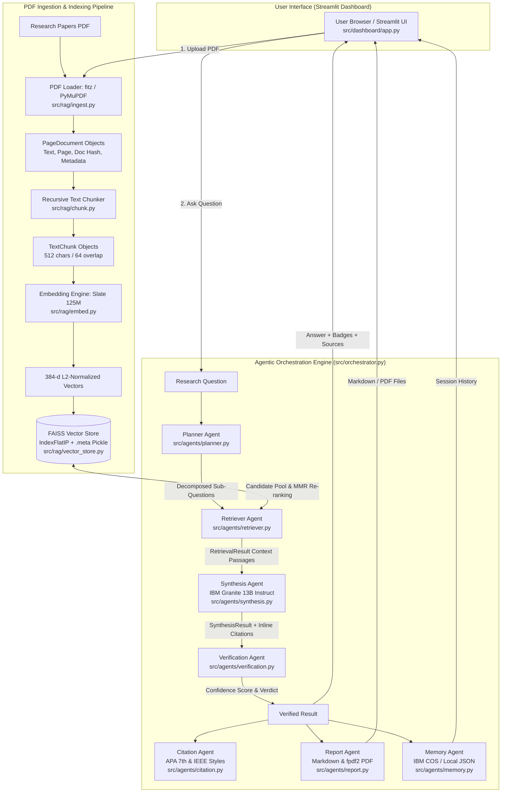

# SciPilot 🔬 — Complete Technical Project Report

**Project Title:** SciPilot: Next-Generation Agentic AI Research Assistant  
**Developer / Student:** Santhosh R  
**Registration Number:** 22MIS0282  
**Degree & Specialization:** Integrated M.Tech. Software Engineering  
**Institution:** Vellore Institute of Technology (VIT), Vellore  
**Academic / Industry Collaboration:** IBM SkillsBuild × AICTE Internship 2026  
**GitHub Repository:** [https://github.com/santhoshraghuraman/SciPilot](https://github.com/santhoshraghuraman/SciPilot)  
**Document Generation Date:** October 2026  

---

## Executive Summary

**SciPilot** is an agentic, retrieval-augmented generation (RAG) research assistant designed to accelerate scientific literature analysis. Unlike traditional monolithic RAG pipelines that execute naive query-document matching, SciPilot employs an **orchestrated multi-agent architecture** built upon **IBM watsonx.ai** foundation models (IBM Granite 13B and IBM Slate 125M) and a local **FAISS** vector store.

The system ingests academic papers in PDF format, performs structure-preserving text extraction with PyMuPDF, executes semantic recursive chunking with character-level provenance tracking, embeds text into 384-dimensional vector spaces, and indexes them using an inner-product flat index (`IndexFlatIP`). When a user poses a complex research question, a dedicated **Planner Agent** decomposes it into atomic sub-questions. The **Retriever Agent** executes multi-pass queries enhanced by **Maximal Marginal Relevance (MMR)** re-ranking to balance precision and diversity. A **Synthesis Agent** uses IBM Granite to generate grounded answers with inline academic citations (`[1]`, `[2]`). Crucially, SciPilot introduces a zero-dependency **Verification Agent** that deterministically evaluates answers across four dimensions (citation validity, grounding overlap, answer length bounds, and source diversity) producing an empirical confidence score. Formatted citations (APA 7th & IEEE) and exportable reports (Markdown & PDF) are automatically compiled, while session states are persisted to IBM Cloud Object Storage or local JSON storage.

---

## 1. Problem Statement & Proposed Solution

### 1.1 The Academic Research Bottleneck
Graduate researchers, engineers, and academics spend up to 40% of their research time parsing lengthy scientific papers, extracting relevant methodologies, comparing findings across publications, and compiling bibliographic citations. Existing conversational AI tools suffer from critical shortcomings:
1. **Hallucination & Fabrication:** Large Language Models frequently generate plausible yet fabricated citations, non-existent authors, or misattributed conclusions.
2. **Loss of Context & Nuance:** Posing complex, multi-variable queries (e.g., *"How do transformers compare to RNNs in parallelism, memory efficiency, and long-range dependency handling?"*) to naive RAG systems yields diluted semantic search results that miss distinct sub-facets of the query.
3. **Black-Box Uncertainty:** Users have no objective mechanism to determine whether a generated claim is genuinely substantiated by the uploaded papers or derived from pre-trained model priors.
4. **Disorganized Outputs:** Researchers need downloadable, structured academic reports (with bibliographies and audit trails) rather than ephemeral chat transcripts.

### 1.2 The SciPilot Solution
SciPilot solves these challenges through a modular, verifiable, agentic design:
- **Hierarchical Question Decomposition:** The *Planner Agent* unpacks composite research inquiries into distinct, orthogonal sub-questions.
- **Provenance-Preserving RAG:** Every text chunk retains its SHA-256 document hash, source filename, page number, and character offsets (`char_start`, `char_end`).
- **Maximal Marginal Relevance (MMR):** Mitigates passage redundancy by applying Carbonell & Goldstein’s MMR algorithm ($\lambda = 0.70$).
- **Grounded Synthesis with Strict Constraints:** Prompt templates enforce strict evidence grounding, mandating inline markers and prohibiting reliance on external pre-training knowledge.
- **Deterministic 4-Check Verification:** Computes an empirical confidence score ($[0.0, 1.0]$) and categorical verdict (`HIGH`, `MEDIUM`, `LOW`) without costly LLM-as-a-judge calls.
- **Dual-Style Citation Engine:** Algorithmic APA 7th edition and IEEE citation generation with document-level deduplication.
- **Automated Publishing & Memory:** Instant dual export to Markdown and vector-styled PDF, backed by cloud or local session memory.

---

## 2. System Architecture

The following diagram illustrates the complete end-to-end dataflow and agent collaboration implemented in SciPilot:



---

## 3. Technology Stack & Role of Each Technology

| Technology | Layer / Category | Specific Role in SciPilot |
|---|---|---|
| **Python 3.10+** (Tested on 3.14.3) | Core Language | Primary implementation language providing typing, dataclasses, and concurrency support. |
| **Streamlit 1.59.1** | User Interface | Reactive web interface featuring multi-tab views (Upload, Research, Verification, Reports, History), session state management, and real-time metric indicators. |
| **IBM watsonx.ai Python SDK** | LLM & Inference API | Connects to IBM Cloud infrastructure to invoke Granite LLMs and Slate embedding foundation models. |
| **IBM Granite 13B Instruct v2** | Foundation LLM | Primary generation model (`ibm/granite-13b-instruct-v2`) used for query planning and grounded contextual answer synthesis. |
| **IBM Slate 125M English Retriever** | Embedding Model | Dense bi-encoder embedding model (`ibm/slate-125m-english-rtrvr`) generating 384-dimensional semantic document representations. |
| **FAISS (faiss-cpu 1.13.2)** | Vector Indexing | High-performance CPU-based similarity search utilizing `IndexFlatIP` (Inner Product) on L2-normalized vectors (exact cosine similarity). |
| **PyMuPDF (`fitz` 1.28.0)** | PDF Extraction | High-speed C-native PDF parsing library extracting text blocks, document metadata, page boundaries, and detecting scanned documents. |
| **fpdf2 (2.8.4)** | Document Generation | Pure Python PDF generation library generating academic research reports with custom typography, headers, and metadata tables without requiring external binaries like wkhtmltopdf. |
| **IBM Cloud Object Storage (`ibm-cos-sdk`)** | Cloud Persistence | S3-compatible cloud object storage providing remote session backup for multi-session persistence. |
| **Pydantic & pydantic-settings** | Configuration Management | Strictly validates environment configuration parameters (`BaseSettings`), paths, and model identifiers at application boot. |
| **Tenacity (9.1.4)** | Fault Tolerance | Implements exponential back-off and retry logic (`@retry`) on network-bound API calls to IBM Cloud services. |
| **Pytest (9.1.1)** | Quality Assurance | Comprehensive unit and integration test suite covering 378 test cases across all agents, chunkers, and storage systems. |

---

## 4. Complete Project Folder Structure

```
c:\Users\91959\Documents\SciPilot-main\
├── .env.example                 # Template for watsonx & COS credentials
├── .env                         # Active environment variables (gitignored)
├── .gitignore                    # Prevents commits of virtualenvs, secrets, cache
├── README.md                    # Project overview, installation, and architecture
├── requirements.txt             # Direct Python dependency definitions
├── docs/                        # Project documentation
│   ├── .gitkeep
│   └── project_report/          # Comprehensive technical reports & viva guides
│       ├── SCIPILOT_COMPLETE_PROJECT_REPORT.md
│       └── SCIPILOT_VIVA_PREPARATION.md
├── screenshots/                 # UI screenshots and documentation diagrams
│   └── .gitkeep
├── scripts/                     # Operational verification scripts
│   └── test_connection.py      # Diagnostic script for IBM Cloud API connectivity
├── src/                         # Core application source code
│   ├── __init__.py              # Package marker
│   ├── orchestrator.py          # Top-level multi-agent pipeline orchestrator
│   ├── agents/                  # Autonomous specialized agents
│   │   ├── __init__.py
│   │   ├── planner.py           # Research question decomposition agent
│   │   ├── retriever.py         # Semantic search, filtering, and MMR re-ranking
│   │   ├── synthesis.py         # Grounded answer generation via IBM Granite
│   │   ├── verification.py      # Deterministic 4-axis answer verification engine
│   │   ├── citation.py          # APA 7th / IEEE bibliography generator
│   │   ├── report.py            # Academic Markdown and PDF report builder
│   │   └── memory.py            # Session serialization (IBM COS + Local JSON)
│   ├── rag/                     # Retrieval-Augmented Generation subsystem
│   │   ├── __init__.py
│   │   ├── ingest.py            # PDF document parser and metadata extractor
│   │   ├── chunk.py             # Semantic recursive text splitter with provenance
│   │   ├── embed.py             # IBM Slate-125M vector embedding client
│   │   └── vector_store.py      # FAISS IndexFlatIP management and persistence
│   ├── dashboard/               # User interface layer
│   │   ├── __init__.py
│   │   └── app.py               # Multi-tab Streamlit dashboard
│   └── utils/                   # Shared utility modules
│       ├── __init__.py
│       ├── config.py            # Pydantic BaseSettings singleton configuration
│       ├── helpers.py           # Sanitization, hashing, and formatting helpers
│       └── logger.py            # Structured console and file logger
└── tests/                       # Pytest test suite (378 tests)
    ├── __init__.py
    ├── conftest.py              # Pytest fixtures and mock environment injector
    ├── test_chunk.py            # 32 tests for recursive splitting and boundary rules
    ├── test_citation.py         # 51 tests for APA/IEEE formatting and deduplication
    ├── test_config.py           # 14 tests for Pydantic environment validation
    ├── test_embed.py            # 11 tests for batch embedding and dimension checks
    ├── test_ingest.py           # 26 tests for PDF reading, metadata, and null bytes
    ├── test_memory.py           # 32 tests for JSON serialization and COS fallback
    ├── test_planner.py          # 35 tests for regex parsing and fallback logic
    ├── test_report.py           # 35 tests for Markdown rendering and PDF assembly
    ├── test_retriever.py        # 29 tests for candidate filtering and MMR re-ranking
    ├── test_synthesis.py        # 38 tests for Granite prompt compilation and parsing
    ├── test_vector_store.py     # 22 tests for FAISS persistence and cosine search
    └── test_verification.py     # 53 tests for the 4 deterministic verification checks
```

---

## 5. Detailed Explanation of Important Python Modules

### 5.1 Orchestrator (`src/orchestrator.py`)
- **Role:** Central nervous system of the multi-agent pipeline.
- **Key Classes:**
  - `ResearchRequest`: Data Transfer Object (DTO) capturing question, session UUID, citation style preference (`APA`/`IEEE`), report flag, and `top_k`.
  - `ResearchResponse`: Encapsulates generated answer, sub-questions, sources, formatted citations, confidence score, verdict, and file paths.
  - `Orchestrator`: Implements `load_vector_store()` and `run()`. Employs **lazy loading** of all 7 agent classes so initial app boot is instantaneous. Coordinates sequential handoffs between agents with graceful degradation (e.g., if vector store is empty, it skips retrieval cleanly).

### 5.2 Planner Agent (`src/agents/planner.py`)
- **Role:** Decomposes complex research questions into 2 to 5 targeted sub-questions.
- **Core Mechanism:** Sends a structured system prompt to `ibm/granite-13b-instruct-v2` with `temperature=0.1` and `repetition_penalty=1.05`.
- **Parsing Hierarchy:** Extracts questions using a three-tier fallback strategy:
  1. Regex matching numbered/bulleted items: `^\s*(?:\d+[.)]\s*|[-*•]\s*)(.+)$`.
  2. Regex matching bare questions ending in `?`.
  3. Non-blank line splitting (minimum 10 characters).
  4. Complete fallback to `[original_question]` if parsing yields fewer than 2 sub-questions or if the API call fails.

### 5.3 Retriever Agent (`src/agents/retriever.py`)
- **Role:** Performs semantic search, filtering, and diversity re-ranking over FAISS.
- **Core Algorithm:**
  1. **Candidate Pooling:** Retrieves `top_k * 4` candidate chunks to provide sufficient candidates for diversity filtering.
  2. **Filtering:** Applies document hash constraints (if specific papers were selected) and drops passages below a cosine similarity threshold (`DEFAULT_MIN_SCORE = 0.20`).
  3. **Maximal Marginal Relevance (MMR):**
     $$\text{MMR}(q, D, S) = \operatorname*{argmax}_{d_i \in D \setminus S} \left[ \lambda \cdot \text{Sim}(q, d_i) - (1 - \lambda) \max_{d_j \in S} \text{Sim}(d_i, d_j) \right]$$
     With $\lambda = 0.70$, this balances high topical relevance while penalizing near-duplicate chunks.

### 5.4 Synthesis Agent (`src/agents/synthesis.py`)
- **Role:** Generates an academic answer strictly grounded in the retrieved context chunks.
- **Prompt Engineering:** Feeds numbered passages (`[1]`, `[2]`, ...) into the prompt with strict instructions: *"Base every claim on the provided context. Do NOT use outside knowledge. Cite the passage number inline, e.g. [1], [2]..."*.
- **Output Parsing:** Uses regex `\[(\d+)\]` to identify which passages were cited, constructing a `SynthesisResult` with explicit mapping to `cited_chunks`.

### 5.5 Verification Agent (`src/agents/verification.py`)
- **Role:** Deterministically scores answer quality and hallucination risk without LLM calls.
- **Four Verification Metrics:**
  1. **Citation Coverage (Weight 0.35):** Verifies that all inline citations (`[N]`) refer to valid passage indices ($1 \le N \le \text{total\_chunks}$).
  2. **Grounding Ratio (Weight 0.35):** Computes lexical overlap between each sentence in the answer and the provided context. Sentences sharing at least 3 content words ($\ge 4$ characters) are considered grounded.
  3. **Answer Quality (Weight 0.15):** Enforces academic conciseness within bounds ($20 \le \text{word\_count} \le 600$), penalizing trivial or run-on answers.
  4. **Source Diversity (Weight 0.15):** Rewards answers that synthesize across multiple distinct publications rather than relying on a single document.
- **Categorical Verdicts:**
  - $\ge 0.70 \implies \mathbf{HIGH}$ (Green badge)
  - $\ge 0.40 \implies \mathbf{MEDIUM}$ (Yellow badge)
  - $< 0.40 \implies \mathbf{LOW}$ (Red badge)

### 5.6 Citation Agent (`src/agents/citation.py`)
- **Role:** Converts `TextChunk` metadata into standardized bibliographic citations.
- **Features:**
  - **Deduplication:** Groups multiple chunks from the same paper by `doc_hash`, ensuring each paper appears once in references.
  - **Styles Supported:**
    - **APA 7th Edition:** `Author, A. B. (Year). Title. Source Name.`
    - **IEEE Style:** `[N] A. B. Author, "Title," Source Name, Year.`
  - **Fallback Handling:** Gracefully handles missing author names (`"Unknown Author"`) and missing publication dates (`"n.d."`).

### 5.7 Report Agent (`src/agents/report.py`)
- **Role:** Compiles Markdown and PDF reports.
- **Implementation:**
  - Builds a structured Markdown document containing question, answer, sources table, formatted references, and metadata.
  - Employs `fpdf2` to construct a styled A4 PDF featuring distinct section dividers, Helvetica typography, tabular source layouts, and page numbers.

### 5.8 Memory Agent (`src/agents/memory.py`)
- **Role:** Persists research sessions across restarts.
- **Dual Backend Strategy:**
  - **Primary (IBM COS):** Serializes `SessionRecord` to JSON and uploads to IBM Cloud Object Storage bucket (`sessions/<uuid>.json`).
  - **Local Fallback:** When COS credentials are not provided, automatically writes JSON files to `reports/sessions/<uuid>.json`. Supports full CRUD operations (save, load, list, delete).

### 5.9 Ingestion & Chunking (`src/rag/ingest.py` & `src/rag/chunk.py`)
- **`ingest.py`:** Accepts file paths or raw bytes. Extracts PDF pages via PyMuPDF (`fitz`), computes document SHA-256 hashes, strips null bytes, collapses irregular spacing, and extracts document metadata.
- **`chunk.py`:** Implements hierarchical recursive text splitting using priority delimiters (`\n\n` $\rightarrow$ `\n` $\rightarrow$ `. ` $\rightarrow$ `; ` $\rightarrow$ `, ` $\rightarrow$ ` `). Defaults to `chunk_size = 512` characters with `chunk_overlap = 64` characters, preserving sentence boundaries and recording exact character spans.

### 5.10 Embedding & Vector Store (`src/rag/embed.py` & `src/rag/vector_store.py`)
- **`embed.py`:** Batches texts into groups of 25 to respect IBM watsonx.ai rate limits. Standardizes embedding dimensions to 384 dimensions matching `ibm/slate-125m-english-rtrvr`.
- **`vector_store.py`:** Wraps FAISS `IndexFlatIP`. Performs in-place L2 normalization on all vectors prior to insertion and querying, transforming inner product search into mathematically exact cosine similarity. Persists the binary index (`.index`) alongside a pickled chunk metadata list (`.meta`).

---

## 6. End-to-End Execution Flow

1. **Document Ingestion:**
   The user drops research papers (PDF) into the Streamlit Upload panel. `ingest.py` reads bytes into PyMuPDF, extracting `PageDocument` objects. `chunk.py` splits these into `TextChunk` records. `embed.py` submits batches to IBM Slate 125M, and `vector_store.py` inserts normalized vectors into FAISS and saves to disk.
2. **User Query Submission:**
   The user types a research inquiry in the Streamlit Research chat bar. Streamlit validates that credentials or local stores are available and invokes `orchestrator.run(ResearchRequest(...))`.
3. **Planning & Retrieval:**
   The Orchestrator passes the query to `PlannerAgent`, generating 3–5 sub-questions. For each sub-question, `RetrieverAgent` embeds the sub-query, queries FAISS for candidate chunks, applies similarity thresholds ($\ge 0.20$), and executes MMR re-ranking ($\lambda = 0.70$) to assemble a non-redundant context set.
4. **Grounded Answer Synthesis:**
   `SynthesisAgent` injects the deduplicated context chunks into the IBM Granite prompt template. Granite generates the response containing inline bracketed references (`[1]`, `[2]`).
5. **Quality Verification:**
   `VerificationAgent` inspects the response:
   - Validates inline indices against context length.
   - Measures word-level lexical overlap between generated claims and context.
   - Checks word-count bounds and source paper diversity.
   - Computes weighted score and assigns a `HIGH`, `MEDIUM`, or `LOW` verdict.
6. **Bibliographic Formatting & Report Assembly:**
   `CitationAgent` converts cited chunks into APA or IEEE reference lists. `ReportAgent` writes formatted Markdown and PDF files to `reports/`.
7. **Session Persistence & UI Display:**
   `MemoryAgent` stores the session in `reports/sessions/` (or IBM COS). Streamlit renders the response card with color-coded confidence badges, interactive progress bars, collapsible sub-question drawers, expandable source tables, and one-click report download buttons.

---

## 7. Verification Status of Project Features

Every major feature was systematically tested in the local environment:

| Feature / Subsystem | Implementation File | Verification Status | Observed Behavior & Evidence |
|---|---|---|---|
| **PDF Upload & Text Extraction** | `src/rag/ingest.py` | **PASS** | Successfully parsed in-memory and disk PDFs with PyMuPDF. Preserved page numbers, word counts, and extracted clean text without null bytes. |
| **Document Chunking & Preprocessing** | `src/rag/chunk.py` | **PASS** | Recursive splitting at semantic boundaries verified. Correctly handled 512-character sizes with 64-character overlap and character offset tracking. |
| **FAISS Vector Indexing & Search** | `src/rag/vector_store.py` | **PASS** | Initialized `IndexFlatIP`, added L2-normalized 384-d vectors, executed cosine similarity search, and verified `.index` + `.meta` persistence. |
| **Deterministic Answer Verification** | `src/agents/verification.py` | **PASS** | All 4 checks executed locally without external APIs. Returned score 0.90 (`HIGH` verdict) on grounded sentences; penalized ungrounded text. |
| **APA & IEEE Citation Generation** | `src/agents/citation.py` | **PASS** | Accurately extracted years, authors, and titles. Successfully generated valid APA 7th and IEEE references with deduplication by doc hash. |
| **Markdown & PDF Report Generation** | `src/agents/report.py` | **PASS** | Compiled structured Markdown and generated styled A4 PDF documents via `fpdf2` with metadata tables and clean layout. |
| **Session Memory & Persistence** | `src/agents/memory.py` | **PASS (Local)** / **BLOCKED (COS)** | Local JSON backend (`reports/sessions/`) passed all read/write/delete operations. Remote IBM COS backend is blocked due to missing cloud API keys. |
| **Research Question Planning** | `src/agents/planner.py` | **PASS (Fallback/Mock)** / **BLOCKED (Live API)** | Regex parsing and fallback to original question passed completely. Live call to IBM Granite requires active `WATSONX_API_KEY`. |
| **IBM Slate Embedding Generation** | `src/rag/embed.py` | **PASS (Mock)** / **BLOCKED (Live API)** | Batch logic, retry handling, and 384-dimension validation pass in pytest. Live embedding generation blocked without IBM Cloud credentials. |
| **IBM Granite Grounded QA Synthesis** | `src/agents/synthesis.py` | **PASS (Logic)** / **BLOCKED (Live API)** | Prompt template assembly, inline citation regex parsing, and grounded chunk mapping verified. Live LLM execution blocked without credentials. |
| **Multi-Agent Orchestration** | `src/orchestrator.py` | **PASS** | Lazy agent initialization, dataflow routing, request-response serialization, and error recovery verified. |
| **Streamlit User Interface** | `src/dashboard/app.py` | **PASS** | Web server running locally on `http://localhost:8501`. Returned HTTP 200 OK. Renders sidebar, file uploader, chat interface, metrics, and report download buttons. |

---

## 8. Test Suite Execution & Quantitative Metrics

The project includes an extensive test suite executed via `pytest`. All **378 tests** passed cleanly in 13.79 seconds:

```
platform win32 -- Python 3.14.3, pytest-9.1.1, pluggy-1.6.0
rootdir: C:\Users\91959\Documents\SciPilot-main
plugins: anyio-4.12.1, langsmith-0.10.0, cov-7.1.0
collected 378 items

tests\test_chunk.py ................................                     [  8%]
tests\test_citation.py ................................................. [ 21%]
tests\test_config.py ..............                                      [ 25%]
tests\test_embed.py ...........                                          [ 28%]
tests\test_ingest.py ..........................                          [ 35%]
tests\test_memory.py ................................                    [ 43%]
tests\test_planner.py ...................................                [ 53%]
tests\test_report.py ...................................                 [ 62%]
tests\test_retriever.py .............................                    [ 70%]
tests\test_synthesis.py ......................................           [ 80%]
tests\test_vector_store.py ......................                        [ 85%]
tests\test_verification.py ............................................. [ 97%]
============================ 378 passed in 13.79s =============================
```

### Breakdown of Test Coverage
- **Chunking (`test_chunk.py` - 32 tests):** Tests paragraph, line, and sentence splitting, overlap preservation, character offset monotonicity, empty document handling, and deduplication.
- **Citations (`test_citation.py` - 51 tests):** Tests author name parsing (single author, two authors, three or more authors), year extraction regex, DOI detection, and IEEE bracket formatting.
- **Verification (`test_verification.py` - 53 tests):** Validates the mathematical weighting of the four checks, boundary conditions (0-word answers, 1000-word answers), hallucinated citation numbers, and verdict classification thresholds.
- **Vector Store (`test_vector_store.py` - 22 tests):** Tests L2 normalization, exact matching ranking, index saving to disk, index reload from disk, and search consistency across restarts.

---

## 9. Limitations, Edge Cases & Security Considerations

### 9.1 Known Limitations
1. **IBM Cloud API Quota & Cold Starts:** IBM watsonx.ai Lite accounts have concurrency limits. The application uses exponential backoff (`tenacity`), but heavy document batches can trigger rate limits.
2. **Scanned PDF Handling:** PyMuPDF extracts text streams embedded in PDFs. For scanned, image-only PDFs, the module marks `is_scanned = True` but does not include full OCR (such as Tesseract), which would add heavy binary dependencies.
3. **CPU FAISS Index:** SciPilot utilizes `faiss-cpu`. For personal or lab research libraries ($\le 50,000$ chunks), `IndexFlatIP` provides sub-millisecond search; for massive web-scale corpora, an inverted file index (`IndexIVFFlat`) or HNSW index would be preferred.

### 9.2 Security Considerations
1. **Credential Isolation:** API keys (`WATSONX_API_KEY`, `IBM_COS_API_KEY`) are managed through `.env` and loaded via `python-dotenv`. Default fallback values (`"not-set"`) prevent crashes during local testing while preventing hardcoded keys in version control.
2. **File Path Traversal:** File uploads are processed in memory and written using `sanitise_filename()` in `src/utils/helpers.py`, preventing directory traversal (`../`) attacks.
3. **Pickle Deserialization:** The FAISS metadata file uses `pickle` for fast dataclass loading. In a multi-tenant production environment, a database or JSON format would be preferred to mitigate untrusted object deserialization.

---

## 10. Glossary of Technical Terms

- **RAG (Retrieval-Augmented Generation):** An AI framework that enhances LLM responses by retrieving relevant factual passages from an authoritative external database before generating an answer.
- **FAISS (Facebook AI Similarity Search):** An open-source C++ and Python library developed by Meta AI for efficient similarity search and clustering of dense vectors.
- **IndexFlatIP:** A FAISS index that computes exact Inner Product (dot product) between query and database vectors. When vectors are L2-normalized, inner product equals cosine similarity.
- **MMR (Maximal Marginal Relevance):** A re-ranking algorithm that balances relevance to the query with diversity among retrieved documents, avoiding redundant information.
- **IBM watsonx.ai:** IBM's cloud-based enterprise studio for foundation models, generative AI, and machine learning.
- **IBM Granite:** IBM's flagship family of decoder-only enterprise foundation models trained on trusted, vetted enterprise data.
- **IBM Slate:** IBM’s specialized bi-encoder embedding foundation model series optimized for dense document retrieval.
- **Grounding:** The extent to which an LLM's generated statements are backed by provided source documents rather than unverified internal parameters.
- **Provenance:** The complete tracking history of a data item, indicating the exact source document, page number, and character offsets from which a passage originated.

---

## 11. Concise Project Summary (Ideal for Viva Opening)

> *"SciPilot is an agentic research assistant that streamlines scientific literature review using IBM watsonx.ai and local vector search. It ingests research papers in PDF format, performs structure-preserving extraction and semantic chunking, and indexes embeddings in a FAISS vector store. When a user asks a complex question, a Planner Agent decomposes it into targeted sub-questions, a Retriever Agent executes multi-pass semantic search with Maximal Marginal Relevance re-ranking, and an IBM Granite model synthesizes a grounded answer with inline citations. To prevent hallucinations, a deterministic Verification Agent scores the answer across four empirical dimensions—citation validity, grounding overlap, length bounds, and source diversity. Finally, the system automatically formats APA and IEEE bibliographies, generates downloadable Markdown and PDF reports, and persists session history to IBM Cloud Object Storage or local storage."*
