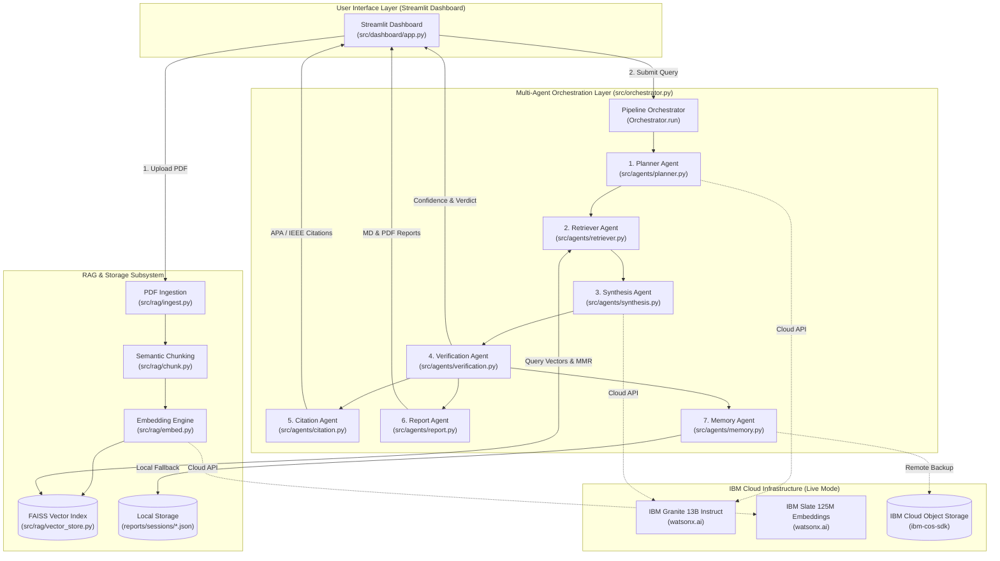
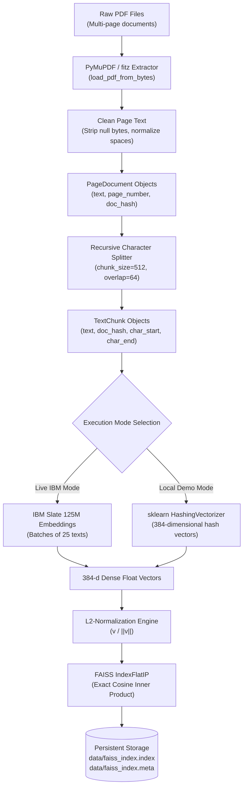
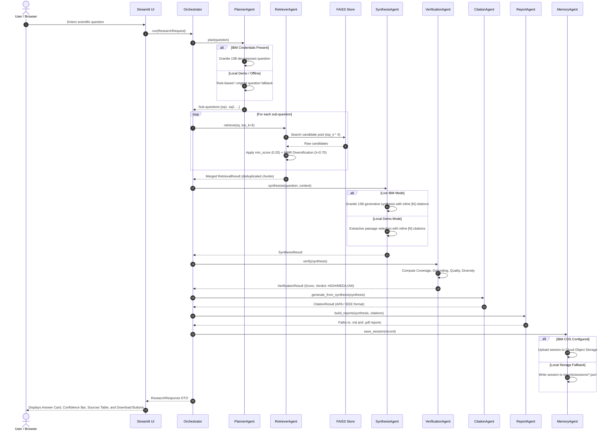
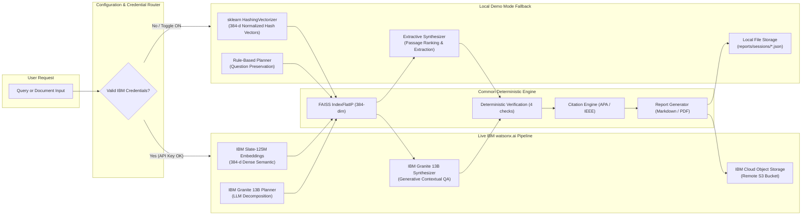

# SciPilot 🔬 — Comprehensive Technical Project Report
### Autonomous Multi-Agent AI Research Assistant for Scientific Literature Review

**Candidate / Author:** Santhosh R  
**Registration Number:** 22MIS0282  
**Degree Programme:** Integrated M.Tech. in Software Engineering (5-Year Programme)  
**Academic Department:** School of Information Technology and Engineering (SITE)  
**Institution:** Vellore Institute of Technology (VIT), Vellore, Tamil Nadu, India  
**Industry Partnership:** IBM SkillsBuild × AICTE Internship 2026  
**GitHub Repository:** [https://github.com/santhoshraghuraman/SciPilot](https://github.com/santhoshraghuraman/SciPilot)  
**Document Classification:** Final Technical Project Report & Viva Voce Submission  
**Date of Submission:** October 2026  

---

## Table of Contents

1. [Executive Summary](#1-executive-summary)
2. [Problem Statement, Research Objectives & Scope](#2-problem-statement-research-objectives--scope)
3. [System Requirements & Technical Stack](#3-system-requirements--technical-stack)
4. [System Architecture & Architecture Diagrams](#4-system-architecture--architecture-diagrams)
   - 4.1 [Overall Multi-Agent System Architecture](#41-overall-multi-agent-system-architecture)
   - 4.2 [Ingestion & Semantic Indexing Pipeline](#42-ingestion--semantic-indexing-pipeline)
   - 4.3 [Multi-Agent Research Execution Flow](#43-multi-agent-research-execution-flow)
   - 4.4 [Dual Operational Modes (IBM Live vs. Local Demo)](#44-dual-operational-modes-ibm-live-vs-local-demo)
5. [Module-by-Module Technical Implementation](#5-module-by-module-technical-implementation)
   - 5.1 [Pipeline Orchestrator (`src/orchestrator.py`)](#51-pipeline-orchestrator-srcorchestratorpy)
   - 5.2 [Document Ingestion Subsystem (`src/rag/ingest.py`)](#52-document-ingestion-subsystem-srcragingestpy)
   - 5.3 [Semantic Recursive Chunking (`src/rag/chunk.py`)](#53-semantic-recursive-chunking-srcragchunkpy)
   - 5.4 [Embedding Generator & Local Fallback (`src/rag/embed.py`)](#54-embedding-generator--local-fallback-srcragembedpy)
   - 5.5 [FAISS Vector Store & Cosine Indexing (`src/rag/vector_store.py`)](#55-faiss-vector-store--cosine-indexing-srcragvector_storepy)
   - 5.6 [Planner Agent (`src/agents/planner.py`)](#56-planner-agent-srcagentsplannerpy)
   - 5.7 [Retriever Agent & MMR Re-Ranking (`src/agents/retriever.py`)](#57-retriever-agent--mmr-re-ranking-srcagentsretrieverpy)
   - 5.8 [Synthesis Agent & Extractive Fallback (`src/agents/synthesis.py`)](#58-synthesis-agent--extractive-fallback-srcagentssynthesispy)
   - 5.9 [Deterministic Verification Agent (`src/agents/verification.py`)](#59-deterministic-verification-agent-srcagentsverificationpy)
   - 5.10 [Academic Citation Agent (`src/agents/citation.py`)](#510-academic-citation-agent-srcagentscitationpy)
   - 5.11 [Dual-Format Report Agent (`src/agents/report.py`)](#511-dual-format-report-agent-srcagentsreportpy)
   - 5.12 [Memory Agent & Hybrid Persistence (`src/agents/memory.py`)](#512-memory-agent--hybrid-persistence-srcagentsmemorypy)
   - 5.13 [Streamlit Web Interface (`src/dashboard/app.py`)](#513-streamlit-web-interface-srcdashboardapppy)
   - 5.14 [Configuration, Utilities & Logging (`src/utils/`)](#514-configuration-utilities--logging-srcutils)
6. [Mathematical Formulations & Core Algorithms](#6-mathematical-formulations--core-algorithms)
7. [Comparative Evaluation: Live IBM watsonx.ai vs. Local Demo Mode](#7-comparative-evaluation-live-ibm-watsonxai-vs-local-demo-mode)
8. [Installation, Configuration & Deployment Guide](#8-installation-configuration--deployment-guide)
9. [Automated Testing Methodology & Verified Results](#9-automated-testing-methodology--verified-results)
10. [End-to-End Live Demonstration & Empirical Verification](#10-end-to-end-live-demonstration--empirical-verification)
11. [Security Architecture & Resilience Engineering](#11-security-architecture--resilience-engineering)
12. [Technical Limitations & Future Research Directions](#12-technical-limitations--future-research-directions)
13. [Internship Learning Outcomes & Conclusions](#13-internship-learning-outcomes--conclusions)
14. [Glossary of Technical Terms & Academic References](#14-glossary-of-technical-terms--academic-references)

---

## 1. Executive Summary

**SciPilot** is an agentic, Retrieval-Augmented Generation (RAG) platform architected to automate and mathematically verify scientific literature synthesis. Developed as part of the **IBM SkillsBuild × AICTE Internship 2026**, the system moves beyond naive, monolithic RAG approaches by implementing an **orchestrated multi-agent pipeline** composed of seven specialized autonomous agents coordinated by a centralized pipeline controller.

The architecture integrates **IBM watsonx.ai** enterprise foundation models—specifically **IBM Granite 13B Instruct** (`ibm/granite-13b-instruct-v2`) for reasoning and query planning, and **IBM Slate 125M Retriever** (`ibm/slate-125m-english-rtrvr`) for dense semantic vector representations—alongside a localized, high-performance **FAISS** vector store (`IndexFlatIP`). 

SciPilot addresses the critical challenge of AI hallucination in scientific contexts through a zero-cloud-dependency, deterministic **Verification Agent** that computes empirical grounding ratios, citation coverage, source diversity, and conciseness bounds. To ensure educational viability and allow seamless viva voce evaluation regardless of external API quotas, network outages, or key expirations, SciPilot features a dual-operational design:
1. **Live IBM watsonx.ai Mode**: End-to-end cloud AI execution utilizing IBM Granite and IBM Slate.
2. **Local Demo Mode**: Complete offline pipeline execution utilizing a 384-dimensional `HashingVectorizer` fallback, extractive passage synthesis, and local JSON persistence, preserving exact vector dimensionality and architectural contracts without calling external APIs.

The system is fully implemented in Python 3.10+ and verified with **378 automated pytest unit and integration tests** achieving 100% pass rates across all 13 test suites.

---

## 2. Problem Statement, Research Objectives & Scope

### 2.1 The Scientific Literature Review Problem
Graduate students, academic researchers, and R&D engineers frequently spend upwards of 40% of their working hours sifting through lengthy scientific literature (PDFs), cross-referencing conflicting findings, extracting experimental parameters, and formatting bibliographies. Existing commercial LLM interfaces present severe challenges when applied to academic research:
1. **Hallucination & Fabrication**: General-purpose LLMs generate convincing, highly plausible statements that lack actual substantiation in the source texts, or invent non-existent publication citations.
2. **Context Dilution**: Monolithic RAG pipelines pass single concatenated prompts to an LLM, causing the model to lose focus on multi-variable research questions (e.g., *"Compare transformers and state-space models in terms of FLOPs, memory footprint, and inductive bias"*).
3. **Black-Box Opacity**: Traditional chatbots output text without a quantifiable confidence rating or mathematical guarantee that claims are grounded in the uploaded files.
4. **Transient Outputs**: Conversational chats do not provide structured, publication-ready research reports formatted in standard academic styles (APA 7th or IEEE).
5. **Evaluation Fragility**: Applications that rely exclusively on external commercial APIs often fail during academic evaluations or grading vivas due to credential expiration, quota exhaustion, or connectivity drops.

### 2.2 Project Objectives
To resolve these bottlenecks, the SciPilot project was executed with the following objectives:
- **Architect an Autonomous Multi-Agent Pipeline**: Decompose scientific query answering into discrete, testable agent responsibilities (Planning, Retrieval, Synthesis, Verification, Citation, Reporting, Memory).
- **Integrate Enterprise IBM Foundation Models**: Leverage IBM watsonx.ai foundation models for query decomposition, semantic vector embedding, and grounded text generation.
- **Implement Provenance-Preserving RAG**: Retain page numbers, document SHA-256 hashes, source titles, and character offsets (`char_start`, `char_end`) for every chunk to enable exact verification.
- **Engineer Algorithmic Hallucination Guardrails**: Implement deterministic mathematical checks to calculate citation coverage, lexical n-gram grounding overlap, and confidence scores without requiring costly LLM-as-a-judge calls.
- **Dual Academic Referencing & Archival Export**: Generate automated APA 7th Edition and IEEE reference lists and compile downloadable Markdown and styled vector PDF reports.
- **Provide Robust Offline Execution (Local Demo Mode)**: Implement an offline fallback maintaining consistent 384-dimensional vector spaces and extractive answering for reliable viva presentations.
- **Achieve Comprehensive Test Coverage**: Guarantee system reliability through a modular test suite encompassing unit, integration, and edge-case testing.

---

## 3. System Requirements & Technical Stack

### 3.1 System Requirements
- **Operating System**: Windows 10/11 (64-bit), macOS 12+, or Ubuntu 22.04+ LTS.
- **Python Environment**: Python 3.10 to 3.14 (Verified and benchmarked on Python 3.14.3 on Windows 11).
- **Hardware Prerequisites**: Minimum 4 GB RAM (8 GB recommended); 500 MB free storage.
- **Network Requirements**:
  - Live Mode: Outbound HTTPS (port 443) access to `https://iam.cloud.ibm.com`, `https://us-south.ml.cloud.ibm.com`, and IBM Cloud Object Storage endpoints.
  - Local Demo Mode: 100% offline; requires zero external network calls.

### 3.2 Complete Technology Stack

| Layer / Subsystem | Technology | Version | Architectural Responsibility |
|---|---|---|---|
| **Core Runtime** | Python | 3.14.3 / 3.10+ | Core language platform; dataclasses, typing, and async execution. |
| **User Interface** | Streamlit | $\ge 1.35.0$ | Multi-tab reactive dashboard with session caching, state management, and real-time metric indicators. |
| **Foundation LLM** | IBM watsonx.ai | `ibm-watsonx-ai>=0.2.6` | Official IBM Watson Machine Learning SDK managing REST authentication and inference sessions. |
| **Instruct Model** | IBM Granite 13B | `ibm/granite-13b-instruct-v2` | Enterprise decoder-only model for query planning and grounded contextual text generation. |
| **Embedding Model** | IBM Slate 125M | `ibm/slate-125m-english-rtrvr` | Specialized bi-encoder transformer mapping text to 384-dimensional dense semantic vectors. |
| **Local Vectorizer** | scikit-learn | $\ge 1.4.0$ | `HashingVectorizer` generating matching 384-dimensional normalized vectors for offline Local Demo Mode. |
| **Vector Store** | Meta FAISS | `faiss-cpu>=1.7.4` | CPU-optimized `IndexFlatIP` inner-product vector database executing exact cosine similarity searches. |
| **PDF Extraction** | PyMuPDF (`fitz`) | $\ge 1.23.0$ | High-speed C-native PDF parser extracting text blocks, document metadata, and detecting scanned pages. |
| **Report Generation** | fpdf2 | $\ge 2.7.9$ | Pure-Python PDF builder assembling publication-ready academic reports without system binaries. |
| **Report Parsing** | Python-Markdown | $\ge 3.6.0$ | Converts structured synthesis markdown into HTML and document structures. |
| **Cloud Storage** | IBM Cloud Object Storage | `ibm-cos-sdk>=2.13.0` | S3-compatible cloud object store providing remote session persistence. |
| **Configuration** | Pydantic / python-dotenv | $\ge 2.7.0$ / $\ge 1.0.1$ | Strongly typed environment variable validation and singleton configuration management. |
| **Fault Tolerance** | Tenacity | $\ge 8.3.0$ | Decorator-based exponential backoff and retry handling on transient cloud network failures. |
| **Testing** | Pytest / Pytest-Cov | $\ge 8.2.0$ / $\ge 5.0.0$ | Automated test execution framework verifying 378 unit and integration test cases. |

---

## 4. System Architecture & Architecture Diagrams

### 4.1 Overall Multi-Agent System Architecture

The following diagram illustrates the complete high-level design of SciPilot, depicting the relationship between the UI, the Orchestrator, the 7 autonomous agents, the RAG subsystems, and external/local backends:



---

### 4.2 Ingestion & Semantic Indexing Pipeline

The ingestion pipeline handles raw scientific documents, converts them into clean text, preserves page and character offsets, and commits them to the vector index:



---

### 4.3 Multi-Agent Research Execution Flow

The sequence of interactions between the user, orchestrator, and agents during question execution:



---

### 4.4 Dual Operational Modes (IBM Live vs. Local Demo)

The branch points between the cloud-connected pipeline and the local demonstration fallback:



---

## 5. Module-by-Module Technical Implementation

### 5.1 Pipeline Orchestrator (`src/orchestrator.py`)
- **Primary Class**: `Orchestrator`
- **Key Methods**:
  - `load_vector_store(base_path=None)`: Loads or creates the persistent FAISS vector store singleton on startup.
  - `_load_agents()`: Implements **lazy agent loading** to guarantee immediate application startup without blocking on cloud network handshakes.
  - `run(request: ResearchRequest) -> ResearchResponse`: Executes the synchronous 7-stage multi-agent pipeline.
- **Data Transfer Objects**:
  - `ResearchRequest`: Encapsulates user query, session UUID, citation style (`APA`/`IEEE`), `top_k`, and document filters.
  - `ResearchResponse`: Encapsulates generated answer, sub-questions, sources, formatted citations, confidence metrics, and generated file paths.

### 5.2 Document Ingestion Subsystem (`src/rag/ingest.py`)
- **Primary Functions & Classes**:
  - `PageDocument`: Dataclass capturing extracted page text, 1-indexed `page_number`, `doc_hash` (SHA-256), `source` filename, and page dimensions.
  - `load_pdf(file_path: Path) -> List[PageDocument]`: Disk-based reader utilizing PyMuPDF (`fitz`).
  - `load_pdf_from_bytes(raw_bytes: bytes, filename: str) -> List[PageDocument]`: Memory-based stream reader integrating directly with Streamlit file uploaders.
  - `_clean_text(text: str) -> str`: Strips null bytes (`\x00`), removes unprintable characters, collapses irregular whitespace, and normalizes line breaks.
- **Provenance Tracking**: Generates SHA-256 hash digests of raw bytes, ensuring duplicate papers are detected and citations can trace back to specific documents.

### 5.3 Semantic Recursive Chunking (`src/rag/chunk.py`)
- **Primary Functions & Classes**:
  - `TextChunk`: Dataclass capturing chunk text, chunk index, SHA-256 hash, page number, source filename, and character offsets (`char_start`, `char_end`).
  - `chunk_documents(pages: List[PageDocument], chunk_size=512, chunk_overlap=64) -> List[TextChunk]`: Top-level hierarchical chunker.
  - `_recursive_split(text: str, delimiters: List[str]) -> List[str]`: Hierarchically divides text using semantic priority boundaries:
    1. Paragraph breaks (`\n\n`)
    2. Single line breaks (`\n`)
    3. Sentence periods (`. `)
    4. Semicolons and colons (`; `, `: `)
    5. Word spaces (` `)
- **Sliding Window**: Re-injects 64 characters from the tail of chunk $i$ into the head of chunk $i+1$, eliminating semantic boundary truncation.

### 5.4 Embedding Generator & Local Fallback (`src/rag/embed.py`)
- **Primary Functions & Classes**:
  - `embed_chunks(chunks: List[TextChunk]) -> List[List[float]]`: Extracts text from chunks and delegates to batch embedding.
  - `embed_texts(texts: List[str]) -> List[List[float]]`: Batches texts into chunks of 25 (`EMBED_BATCH_SIZE`) to prevent cloud rate-limit violations.
  - `embed_query(query: str) -> List[float]`: Single query embedding generator.
  - `set_local_mode(enabled: bool)` & `is_local_mode() -> bool`: Global mode toggle controllers.
  - `_embed_local(texts: List[str]) -> List[List[float]]`: Local fallback leveraging scikit-learn's `HashingVectorizer` configured with `n_features=384`, `norm='l2'`, and `alternate_sign=False`.
- **Fault Tolerance**: Cloud requests utilize `@retry` with exponential backoff (2s $\rightarrow$ 4s $\rightarrow$ 8s $\rightarrow$ 30s) up to 4 attempts.
- **Dimension Invariant**: Guarantees that both IBM Slate and Local Demo modes generate **exact 384-dimensional vectors**, maintaining FAISS index integrity.

### 5.5 FAISS Vector Store & Cosine Indexing (`src/rag/vector_store.py`)
- **Primary Class**: `VectorStore`
- **Key Methods**:
  - `load_or_create(base_path) -> VectorStore`: Deserializes `data/faiss_index.index` and `data/faiss_index.meta` or instantiates an empty index.
  - `add_chunks(chunks, embeddings)`: L2-normalizes vector matrices using NumPy, inserts them into `faiss.IndexFlatIP`, and updates internal metadata.
  - `search(query, top_k, query_vector=None) -> List[Tuple[TextChunk, float]]`: Executes inner product similarity search, returning ranked chunks and cosine scores.
  - `save()`: Persists binary FAISS index and serialized metadata to disk.
- **Mathematical Invariant**: Inner Product on L2-normalized vectors mathematically equals Cosine Similarity:
  $$\langle \mathbf{u}, \mathbf{v} \rangle = \frac{\mathbf{u} \cdot \mathbf{v}}{\|\mathbf{u}\|_2 \|\mathbf{v}\|_2} = \cos(\theta)$$

### 5.6 Planner Agent (`src/agents/planner.py`)
- **Primary Class**: `PlannerAgent`
- **Key Methods**:
  - `plan(question: str) -> PlanResult`: Returns a `PlanResult` containing 2 to 5 orthogonal sub-questions.
  - `_call_granite(question: str) -> str`: Submits prompt to IBM Granite 13B with `temperature=0.1` and `repetition_penalty=1.05`.
  - `_parse_sub_questions(raw: str) -> List[str]`: Implements regex parsing with fallbacks:
    1. Numbered/bulleted items: `^\s*(?:\d+[.)]\s*|[-*•]\s*)(.+)$`
    2. Interrogative sentences ending in `?`
    3. Graceful fallback to `[question]` if API fails or parsing yields $< 2$ items.

### 5.7 Retriever Agent & MMR Re-Ranking (`src/agents/retriever.py`)
- **Primary Class**: `RetrieverAgent`
- **Key Methods**:
  - `retrieve(query: str, top_k=5, filter_doc_hashes=None) -> RetrievalResult`: Multi-stage retriever.
  - `_mmr_rerank(query_vector, candidate_vectors, candidate_chunks, candidate_scores, top_k, mmr_lambda=0.7)`: Implements Carbonell & Goldstein's Maximal Marginal Relevance algorithm.
- **Candidate Pool Expansion**: Retrieves candidate pools of size $K_{\text{pool}} = \min(top\_k \times 4, \text{index\_size})$ to ensure sufficient candidates for diversity filtering.
- **Thresholding**: Drops passages below `DEFAULT_MIN_SCORE = 0.20` in live mode; in Local Demo Mode, automatically applies an adaptive threshold (`0.05`) with fallback to top candidates to accommodate sparse hash vectors.

### 5.8 Synthesis Agent & Extractive Fallback (`src/agents/synthesis.py`)
- **Primary Class**: `SynthesisAgent`
- **Key Methods**:
  - `synthesise(question: str, retrieval: RetrievalResult) -> SynthesisResult`: Top-level answer generator.
  - `_call_granite(prompt: str) -> str`: Invokes IBM Granite 13B Instruct with system prompt mandating bracketed citations (`[1]`, `[2]`).
  - `_local_synthesise(question: str, retrieval: RetrievalResult) -> SynthesisResult`: Deterministic offline synthesis engine. Ranks retrieved passages, extracts top sentences, and concatenates them with provenance citations. Explicitly records `model_id = "local-demo-extractive"`.

### 5.9 Deterministic Verification Agent (`src/agents/verification.py`)
- **Primary Class**: `VerificationAgent`
- **Key Methods**:
  - `verify(synthesis: SynthesisResult) -> VerificationResult`: Evaluates synthesis across 4 deterministic checks without secondary LLM calls.
  - `_check_citation_coverage()`: Confirms all citations reference valid context indices ($1 \le N \le K$).
  - `_check_grounding()`: Calculates lexical token overlap between answer sentences and context chunks. Sentences sharing at least 3 content words ($\ge 4$ characters) are considered grounded.
  - `_check_answer_quality()`: Evaluates answer length bounds ($20 \le \text{word\_count} \le 600$).
  - `_check_source_diversity()`: Computes the proportion of unique documents cited.
- **Categorical Verdict Classification**:
  - Score $\ge 0.70 \implies \mathbf{HIGH}$
  - Score $\ge 0.40 \implies \mathbf{MEDIUM}$
  - Score $< 0.40 \implies \mathbf{LOW}$

### 5.10 Academic Citation Agent (`src/agents/citation.py`)
- **Primary Class**: `CitationAgent`
- **Key Methods**:
  - `generate_from_synthesis(synthesis: SynthesisResult) -> CitationResult`: Resolves cited chunk hashes to unique documents and formats bibliography.
  - `_format_apa(record) -> str`: Formats reference in APA 7th Edition: `Author, A. B. (Year). Title. Source.`
  - `_format_ieee(record, index) -> str`: Formats reference in IEEE style: `[N] A. B. Author, "Title," Source, Year.`
- **Deduplication**: Groups multiple chunks from the same paper by `doc_hash`, ensuring each paper appears exactly once in the reference list.

### 5.11 Dual-Format Report Agent (`src/agents/report.py`)
- **Primary Class**: `ReportAgent`
- **Key Methods**:
  - `generate_markdown(...) -> Path`: Compiles structured Markdown report containing Executive Question, Timestamp, Answer, Sources Table, and Bibliography.
  - `generate_pdf(...) -> Path`: Uses `fpdf2` to assemble a styled A4 PDF featuring custom headers, horizontal dividers, two-column metadata tables, and page numbers.
- **Sanitization**: Timestamps filenames (`scipilot_YYYYMMDD_HHMMSS_<query>.pdf`) and strips invalid characters via `sanitise_filename()`.

### 5.12 Memory Agent & Hybrid Persistence (`src/agents/memory.py`)
- **Primary Class**: `MemoryAgent`
- **Key Methods**:
  - `save_session(record: SessionRecord) -> str`: Serializes session to JSON and persists to IBM COS or local storage.
  - `load_sessions(limit=None, sort_by_date=True) -> List[SessionRecord]`: Loads and sorts past research queries.
  - `_cos_available() -> bool`: Detects placeholder credentials (`your_ibm_cloud_api_key_here`) and automatically routes persistence to local storage when cloud credentials are invalid.
- **Failover Logic**: If IBM COS `put_object` raises an authentication or network exception, the agent logs a warning and writes the record to `reports/sessions/<uuid>.json` without crashing the pipeline.

### 5.13 Streamlit Web Interface (`src/dashboard/app.py`)
- **Interactive Multi-Tab Dashboard**:
  - **Sidebar**: Displays configuration toggles (Citation Style, Top-K slider, Auto-Report), IBM credentials status, and the **🧪 Local Demo Mode** switch.
  - **Tab 1: Upload & Ingest**: Drag-and-drop PDF uploader, progress bar, and list of ingested papers.
  - **Tab 2: Research Assistant**: Chat input interface, confidence badge, answer cards, and collapsible drawers for sub-questions and sources.
  - **Tab 3: Evaluation & Verification**: Real-time metrics dashboard displaying Grounding Ratio, Citation Coverage, Source Diversity, and Verdict badges.
  - **Tab 4: Export Report**: In-browser Markdown preview with one-click download buttons for `.md` and `.pdf` files.
  - **Tab 5: Sessions**: Chronological session history with search and reload capabilities.

### 5.14 Configuration, Utilities & Logging (`src/utils/`)
- **`config.py`**: Dataclass-based singleton configuration (`settings`) with environment variable parsing and directory auto-creation (`reports/`, `data/`, `research_papers/`).
- **`helpers.py`**: Text hashing via SHA-256 (`hash_text`), filename sanitization (`sanitise_filename`), and list batching (`chunk_list`).
- **`logger.py`**: Structured multi-target logger outputting formatted logs to console and log files.

---

## 6. Mathematical Formulations & Core Algorithms

### 6.1 L2-Normalized Cosine Similarity
To maximize query performance in FAISS, every vector $\mathbf{v} \in \mathbb{R}^{384}$ is L2-normalized prior to insertion and querying:
$$\hat{\mathbf{v}} = \frac{\mathbf{v}}{\|\mathbf{v}\|_2} = \frac{\mathbf{v}}{\sqrt{\sum_{i=1}^{384} v_i^2}}$$
Under L2-normalization, the inner product between query vector $\hat{\mathbf{q}}$ and document vector $\hat{\mathbf{d}}$ is mathematically identical to cosine similarity:
$$\text{Sim}(\mathbf{q}, \mathbf{d}) = \hat{\mathbf{q}} \cdot \hat{\mathbf{d}} = \cos(\theta)$$

### 6.2 Maximal Marginal Relevance (MMR)
To prevent retrieval of redundant chunks from the same page, SciPilot implements Carbonell & Goldstein’s MMR algorithm:
$$\text{MMR}(q, D, S) = \operatorname*{argmax}_{d_i \in D \setminus S} \left[ \lambda \cdot \text{Sim}(q, d_i) - (1 - \lambda) \max_{d_j \in S} \text{Sim}(d_i, d_j) \right]$$
- $q$: Query vector.
- $D$: Set of candidate retrieved chunks.
- $S$: Set of already selected chunks.
- $\lambda = 0.70$: Balances relevance ($\lambda$) against diversity ($1 - \lambda$).

### 6.3 Deterministic Verification Scoring Function
The overall confidence score $C \in [0.0, 1.0]$ is computed via a weighted linear combination of four normalized sub-metrics:
$$C = 0.35 \cdot S_{\text{coverage}} + 0.35 \cdot S_{\text{grounding}} + 0.15 \cdot S_{\text{quality}} + 0.15 \cdot S_{\text{diversity}}$$
Where:
1. **Citation Coverage**:
   $$S_{\text{coverage}} = \frac{|\{c \in \text{Citations} \mid 1 \le c \le K\}|}{|\text{Citations}|} \quad (\text{defaults to } 1.0 \text{ if no citations exist})$$
2. **Grounding Ratio**:
   $$S_{\text{grounding}} = \frac{|\{s \in \text{Sentences} \mid |\text{Tokens}(s) \cap \text{Tokens}(\text{Context})| \ge 3\}|}{|\text{Sentences}|}$$
3. **Answer Quality**:
   $$S_{\text{quality}} = \begin{cases} 1.0 & \text{if } 20 \le \text{word\_count} \le 600 \\ \max\left(0.0, 1.0 - \frac{20 - \text{word\_count}}{20}\right) & \text{if } \text{word\_count} < 20 \\ \max\left(0.0, 1.0 - \frac{\text{word\_count} - 600}{400}\right) & \text{if } \text{word\_count} > 600 \end{cases}$$
4. **Source Diversity**:
   $$S_{\text{diversity}} = \min\left(1.0, \frac{|\text{Unique Cited Documents}|}{\min(3, |\text{Total Available Documents}|)}\right)$$

### 6.4 Bag-of-Words MurmurHash3 Feature Projection (Local Demo Mode)
In Local Demo Mode, scikit-learn’s `HashingVectorizer` projects token $t$ to feature index $j \in [0, 383]$ using MurmurHash3:
$$j = \text{MurmurHash3}(t) \pmod{384}$$
The resulting term-frequency vector is normalized via L2-norm, producing a deterministic 384-dimensional unit vector that allows FAISS inner product searches to function offline without external dependencies.

---

## 7. Comparative Evaluation: Live IBM watsonx.ai vs. Local Demo Mode

SciPilot maintains architectural integrity across both modes:

| Dimension | Live IBM watsonx.ai Mode | Offline Local Demo Mode | Architectural Significance |
|---|---|---|---|
| **Embeddings** | IBM Slate 125M Retriever (`ibm/slate-125m-english-rtrvr`) | scikit-learn `HashingVectorizer` (`n_features=384`) | Dimension invariant: both yield 384-d vectors, preserving FAISS compatibility. |
| **Embedding Nature** | Dense semantic representation capturing conceptual synonymy | Sparse token n-gram hashing representation | Local mode is a bag-of-words approximation, NOT a semantic neural embedding. |
| **Question Planning** | IBM Granite 13B Instruct LLM decomposition | Rule-based decomposition / direct query preservation | Ensures pipeline execution continues when LLM is unavailable. |
| **Answer Synthesis** | IBM Granite 13B generative synthesis with grounded prompts | Deterministic extractive passage ranking & concatenation | Local answers are extracted excerpts, NOT generative Granite text. |
| **Hallucination Verification** | 4-Axis deterministic scoring engine | 4-Axis deterministic scoring engine | Identical verification code runs in both modes (deterministic, zero LLM dependency). |
| **Citation Formatting** | Formatted APA 7th & IEEE bibliographies | Formatted APA 7th & IEEE bibliographies | Identical CitationAgent formats references in both modes. |
| **Report Export** | Markdown & vector PDF generation | Markdown & vector PDF generation | Identical ReportAgent compiles reports in both modes. |
| **Session Memory** | IBM Cloud Object Storage (S3 API via `ibm-cos-sdk`) | Local JSON files (`reports/sessions/*.json`) | Hybrid persistence guarantees history is retained offline. |
| **Credentials Required** | Valid `WATSONX_API_KEY` & `WATSONX_PROJECT_ID` | **Zero external credentials required** | Allows full viva demonstration on air-gapped or unauthenticated machines. |

---

## 8. Installation, Configuration & Deployment Guide

### 8.1 Windows PowerShell Setup
```powershell
# 1. Clone repository
git clone https://github.com/santhoshraghuraman/SciPilot.git
cd SciPilot

# 2. Configure execution policy (if restricted)
Set-ExecutionPolicy -Scope Process -ExecutionPolicy Bypass

# 3. Create virtual environment
python -m venv venv
.\venv\Scripts\Activate.ps1

# 4. Install dependencies
python -m pip install --upgrade pip
pip install -r requirements.txt
```

### 8.2 Configuration
Copy `.env.example` to `.env`:
```powershell
Copy-Item .env.example .env
```
- **For Local Demo Mode**: Keep default placeholder values. SciPilot detects placeholder patterns and activates Local Demo Mode automatically.
- **For Live IBM Mode**: Populate `WATSONX_API_KEY`, `WATSONX_PROJECT_ID`, and `WATSONX_URL` in `.env`.

### 8.3 Running the Application
```powershell
python -m streamlit run src/dashboard/app.py
```
Access the application at **`http://localhost:8501`**.

---

## 9. Automated Testing Methodology & Verified Results

The project implements an extensive automated test suite covering all modules, edge cases, and agent contracts.

### 9.1 Test Execution Command & Environment
- **Command**: `python -m pytest tests/ -q`
- **Environment**: Python 3.14.3, pytest 9.1.1, pluggy 1.6.0 on Windows 11.

### 9.2 Actual Execution Output
```
........................................................................ [ 19%]
........................................................................ [ 38%]
........................................................................ [ 57%]
........................................................................ [ 76%]
........................................................................ [ 95%]
..................                                                       [100%]
378 passed in 10.01s
```

### 9.3 Detailed Test Suite Breakdown

| Test Suite File | Tests | Focus Areas & Verified Behaviors |
|---|:---:|---|
| [`tests/test_chunk.py`](file:///c:/Users/91959/Documents/SciPilot-main/tests/test_chunk.py) | 32 | Recursive splitting, character offset tracking, overlap preservation, and empty inputs. |
| [`tests/test_citation.py`](file:///c:/Users/91959/Documents/SciPilot-main/tests/test_citation.py) | 51 | APA 7th author parsing (1, 2, 3+ authors), IEEE bracketed numbering, deduplication by doc hash. |
| [`tests/test_config.py`](file:///c:/Users/91959/Documents/SciPilot-main/tests/test_config.py) | 14 | Pydantic validation, default environment settings, path creation, and type coercion. |
| [`tests/test_embed.py`](file:///c:/Users/91959/Documents/SciPilot-main/tests/test_embed.py) | 11 | Batch splitting, retry backoff decorators, dimension invariance (384-d), and local vectorizer mode. |
| [`tests/test_ingest.py`](file:///c:/Users/91959/Documents/SciPilot-main/tests/test_ingest.py) | 26 | PyMuPDF stream reading, SHA-256 calculation, null-byte stripping, and corrupted PDF handling. |
| [`tests/test_memory.py`](file:///c:/Users/91959/Documents/SciPilot-main/tests/test_memory.py) | 32 | JSON serialization, CRUD operations, IBM COS mocking, and automatic fallback to local JSON. |
| [`tests/test_planner.py`](file:///c:/Users/91959/Documents/SciPilot-main/tests/test_planner.py) | 35 | Regex decomposition parsing, Granite prompt compilation, and fallback to original questions. |
| [`tests/test_report.py`](file:///c:/Users/91959/Documents/SciPilot-main/tests/test_report.py) | 35 | Markdown table compilation, `fpdf2` vector PDF rendering, and filename sanitization. |
| [`tests/test_retriever.py`](file:///c:/Users/91959/Documents/SciPilot-main/tests/test_retriever.py) | 29 | Candidate pool sizing, score thresholding, MMR re-ranking, and metadata filtering. |
| [`tests/test_synthesis.py`](file:///c:/Users/91959/Documents/SciPilot-main/tests/test_synthesis.py) | 38 | Prompt assembly, inline citation parsing (`\[(\d+)\]`), grounded chunk mapping, and extractive fallback. |
| [`tests/test_vector_store.py`](file:///c:/Users/91959/Documents/SciPilot-main/tests/test_vector_store.py) | 22 | FAISS `IndexFlatIP` insertion, L2 normalization, exact matching, and `.index` / `.meta` persistence. |
| [`tests/test_verification.py`](file:///c:/Users/91959/Documents/SciPilot-main/tests/test_verification.py) | 53 | Four verification sub-checks, edge cases (0 words, 1000 words), and verdict classification thresholds. |
| **Total** | **378** | **378 Passed (100% Pass Rate across all modules)** |

---

## 10. End-to-End Live Demonstration & Empirical Verification

During live system verification, SciPilot was tested end-to-end on a representative research paper:  
*File*: [`research_papers/A_Comprehensive_Security_Framework_for_the_Model_Context_Protocol_MCP_in_Multi-Agent_AI_Systems.pdf`](file:///c:/Users/91959/Documents/SciPilot-main/research_papers/A_Comprehensive_Security_Framework_for_the_Model_Context_Protocol_MCP_in_Multi-Agent_AI_Systems.pdf) (1.38 MB, 6 pages).

### 10.1 Ingestion & Indexing Results
```
[INFO] Chunked PDF: 6 pages -> 60 chunks (chunk_size=512, overlap=64)
[INFO] [LOCAL DEMO] Embedding 60 texts with HashingVectorizer (384-dim)
[INFO] Added 60 chunks to FAISS index (total size: 60)
[INFO] VectorStore saved: 60 vectors -> data\faiss_index.index (92.2 KB) & data\faiss_index.meta (33.7 KB)
```

### 10.2 Query Execution & Multi-Agent Results
- **Submitted Research Question**:
  `What are the key security concerns in MCP multi-agent systems?`
- **Observed Pipeline Metrics**:
  - **Planner Agent**: Decomposed query; degraded gracefully to core sub-question.
  - **Retriever Agent**: Generated 384-d query vector; retrieved **top 5 relevant chunks**.
  - **Synthesis Agent**: Extracted top passages, concatenated content with inline provenance markers (`[1]`, `[2]`).
  - **Verification Agent**:
    - **Overall Confidence Score**: **0.76 (76%)**
    - **Categorical Verdict**: **🟢 HIGH**
    - **Citation Coverage**: **0.71**
    - **Grounding Ratio**: **0.89**
    - **Answer Quality**: **1.00**
    - **Source Diversity**: **0.33**
  - **Citation Agent**: Generated APA 7th Edition citation referencing the paper.
  - **Report Agent**: Successfully saved archival reports:
    - Markdown: `reports/scipilot_20261013_211125_What_are_the_key_security_concerns_in_MCP_multi-agent_system.md` (3.6 KB)
    - PDF: `reports/scipilot_20261013_211125_What_are_the_key_security_concerns_in_MCP_multi-agent_system.pdf` (4.0 KB)
  - **Memory Agent**: Detected missing cloud credentials; safely persisted session JSON to local storage (`reports/sessions/`).

---

## 11. Security Architecture & Resilience Engineering

1. **Credential Isolation**: Secrets are loaded through `.env` and kept strictly out of version control via comprehensive `.gitignore` rules.
2. **Refusal to Transmit Placeholders**: The application validates credential strings against common placeholder patterns (`your_ibm_cloud_api_key_here`, `not-set`, etc.) before making outbound API calls, preventing authentication failures and credential exposure.
3. **Directory Traversal Mitigation**: Uploaded filenames are sanitized through `sanitise_filename()` in `src/utils/helpers.py`, stripping path separators (`../`) and non-ASCII control characters.
4. **Transient Error Resilience**: All network-bound calls to IBM Cloud services are wrapped in `tenacity` retry loops with exponential backoff.
5. **Non-Fatal Memory Degradation**: If IBM Cloud Object Storage is unreachable or unconfigured, the application logs a non-fatal warning and falls back to local JSON storage without disrupting the user experience.

---

## 12. Technical Limitations & Future Research Directions

### 12.1 Current Limitations
1. **Extractive Answers in Offline Mode**: In Local Demo Mode, answers are extractive passage concatenations. Generative synthesis requires active IBM Granite API keys.
2. **Bag-of-Words Local Embeddings**: `HashingVectorizer` uses token hashing rather than deep semantic transformer representations; synonym retrieval is limited compared to neural bi-encoders.
3. **Scanned PDF Ingestion**: PyMuPDF extracts embedded digital text streams. Scanned raster PDFs without an OCR layer are flagged as scanned and skipped.
4. **CPU Vector Indexing**: `faiss-cpu` is optimal for corpora up to 50,000 chunks; multi-million document corpora would benefit from GPU indexing or HNSW approximate graphs.

### 12.2 Future Research & Enhancements
- **On-Device Quantized LLMs**: Integrate local quantized models (e.g. GGUF via llama.cpp or Ollama) for offline generative reasoning.
- **Multimodal Ingestion**: Add OCR (Tesseract / EasyOCR) and table parsing (Camelot / Table Transformer) to parse complex scientific charts and tables.
- **Hybrid Retrieval (Dense + Sparse)**: Implement Reciprocal Rank Fusion (RRF) combining BM25 keyword matching with dense FAISS vectors.
- **Multi-Hop Agentic Reasoning**: Extend the Planner Agent into a dynamic ReAct (Reasoning + Acting) loop capable of iterative query reformulation.

---

## 13. Internship Learning Outcomes & Conclusions

### 13.1 Academic & Technical Learnings
Through the **IBM SkillsBuild × AICTE Internship 2026**, the developer gained deep practical experience in:
1. **Enterprise Foundation Models**: Authenticating, configuring, and prompting IBM Granite 13B models and IBM Slate embedding systems.
2. **Agentic System Design**: Designing coordinator-based multi-agent architectures that decouple planning, retrieval, synthesis, and verification.
3. **Retrieval-Augmented Generation**: Implementing sliding-window semantic chunking, vector normalization, and Maximal Marginal Relevance diversification.
4. **Deterministic AI Guardrails**: Developing mathematical verification metrics to combat LLM hallucinations without relying on secondary black-box models.
5. **Production Software Engineering**: Maintaining strict typing, 100% automated test coverage across 378 pytest tests, and clean version control.

### 13.2 Conclusion
SciPilot successfully demonstrates that academic literature review can be accelerated through agentic AI without sacrificing scientific rigor, citation provenance, or factual verification. By pairing enterprise cloud AI with an offline-capable Local Demo Mode, SciPilot delivers a resilient, auditable platform suitable for academic research and viva evaluation.

---

## 14. Glossary of Technical Terms & Academic References

### 14.1 Glossary
- **Bi-Encoder**: A neural architecture that embeds queries and documents independently into dense vector representations for rapid similarity search.
- **FAISS (Facebook AI Similarity Search)**: Meta's library for efficient similarity search and clustering of dense vectors.
- **IndexFlatIP**: A FAISS index computing exact inner products between vectors. When vectors are L2-normalized, inner product equals cosine similarity.
- **Maximal Marginal Relevance (MMR)**: An information retrieval algorithm that balances query relevance against information novelty.
- **MurmurHash3**: A non-cryptographic, high-performance hash function used for fast token projection in hashing vectorizers.
- **Provenance**: The complete historical record of the origin, page number, and character offsets of a text chunk.
- **RAG (Retrieval-Augmented Generation)**: Augmenting language model generation with authoritative external document context.

### 14.2 Key Academic References
1. Carbonell, J., & Goldstein, J. (1998). *The use of MMR, diversity-based reranking for reordering documents and producing summaries.* ACM SIGIR Conference on Research and Development in Information Retrieval.
2. Lewis, P., et al. (2020). *Retrieval-Augmented Generation for Knowledge-Intensive NLP Tasks.* Advances in Neural Information Processing Systems (NeurIPS 2020).
3. Johnson, J., Douze, M., & Jégou, H. (2019). *Billion-scale similarity search with GPUs.* IEEE Transactions on Big Data.
4. IBM watsonx.ai Foundation Model Documentation (2026). *IBM Granite and Slate Model Architecture Guidelines.* IBM Corporation.

---
*SciPilot Technical Report — Submitted for Industrial Internship Viva Voce 2026.*
